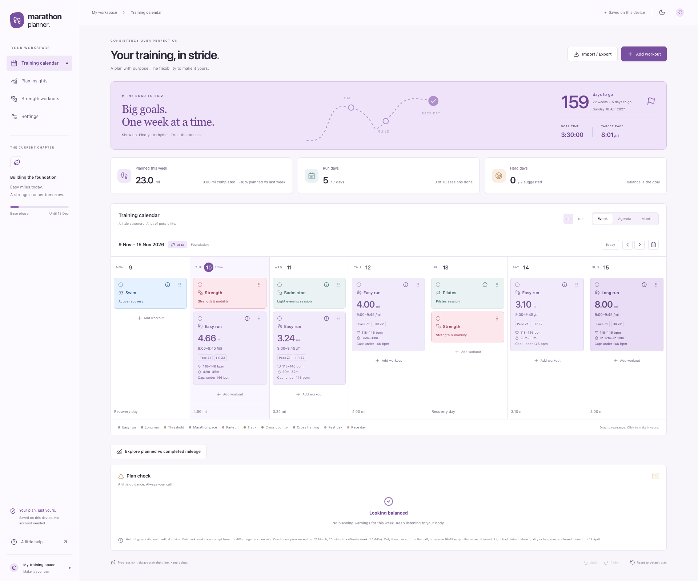
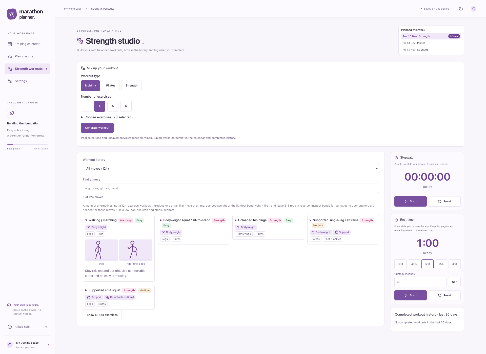

# Marathon Planner

**Python-validated training plans, with a local-first calendar to make them your own.**

[Open the live app on Vercel](https://training-calendar-running.vercel.app)

Python revises and checks the marathon plan; a React + TypeScript app lets you arrange sessions, track completion, inspect mileage and generate supporting workouts. The included plan targets the 18 April 2027 marathon.

No backend, account, API key or external service is required. Your calendar is saved in your browser; export JSON backups to keep a portable copy.

## In pictures

### Training calendar



### Strength Studio



Screenshots show the included plan at a 1920-pixel desktop width. Click an image to view it at full size.

## The Python part

The [plan revision script](scripts/revise_plan.py) uses **only the Python standard library** to:

- Load an exported JSON plan and revise a copy without changing its schema.
- Calculate weekly running mileage and main-set quality distances.
- Apply the build, cut-backs, quality sessions, strength schedule and taper.
- Validate dates, IDs, numeric values, mileage progression and recovery constraints.
- Check a JSON round-trip before writing the revised plan and a detailed change log.

[Python unit tests](scripts/test_revise_plan.py) cover the revision, validation failures and command-line workflow. These are personal planning checks, not a guarantee of safe training.

From this directory, with Python 3 available:

```sh
# Run the Python tests; no pip install needed.
PYTHONDONTWRITEBYTECODE=1 python3 -m unittest discover -s scripts -v

# Revise a separate original export and produce a change log.
python3 scripts/revise_plan.py /path/to/original-plan.json marathon-plan-v2.json
```

The script is specific to the included race date and training decisions, not a general-purpose plan generator. Python runs offline during plan preparation; the browser app does not run a Python server.

See [Python tooling and development](docs/python-and-development.md) for the data flow, validation rules and app-default generation.

## Run the app

Use Node.js 22.12+, 24+ or 26+:

```sh
npm install
npm run dev
```

Open the localhost URL printed by Vite. Python is not needed to run the app with its checked-in plan.

```sh
npm test          # Browser-app unit tests
npm run build    # Type-check and production build
npm run preview  # Serve the production build locally
```

## What you can do

- **Plan:** edit, drag, move or copy sessions in Week, Agenda and Month views.
- **Review:** compare planned/completed mileage, pace and HR targets, and recovery warnings.
- **Support your running:** generate Strength, Pilates and Mobility workouts, browse illustrated movements and use workout timers.
- **Keep your data:** save locally, undo changes and import/export JSON or calendar events.

## Detailed guides

| Guide | Contents |
| --- | --- |
| [Python tooling and development](docs/python-and-development.md) | Revision script, tests, validation, data flow and source map |
| [Training plan](docs/training-plan.md) | Weekly targets, quality sessions, recovery exceptions and taper |
| [Calendar and data](docs/calendar-guide.md) | Editing, navigation, insights, zones, fuelling, settings and backups |
| [Strength Studio](docs/strength-studio.md) | Exercise pools, library, workout flow, timers and saving |

The app uses React, TypeScript, Vite, Tailwind CSS, dnd-kit, Zustand, date-fns, Recharts and Lucide. The Python tooling uses `argparse`, `datetime`, `json`, `pathlib`, `unittest` and other standard-library modules.
